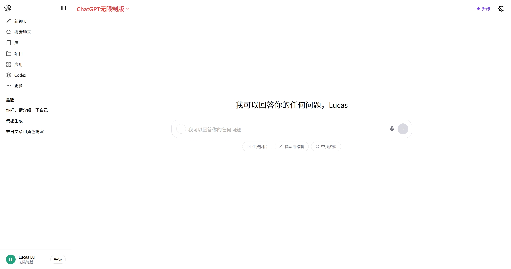
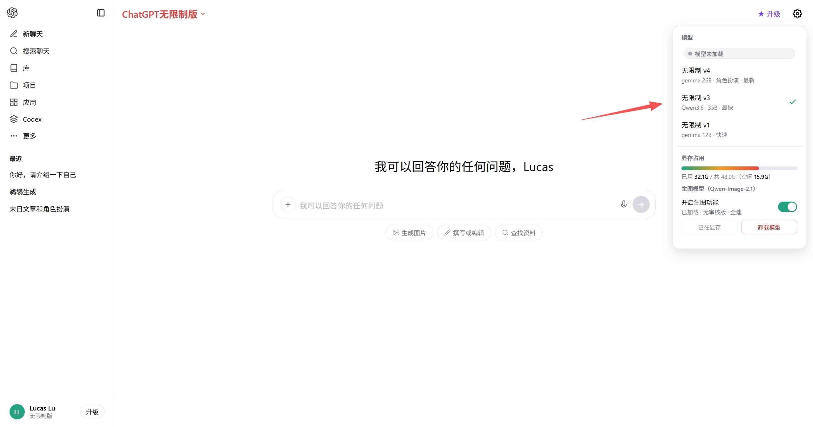
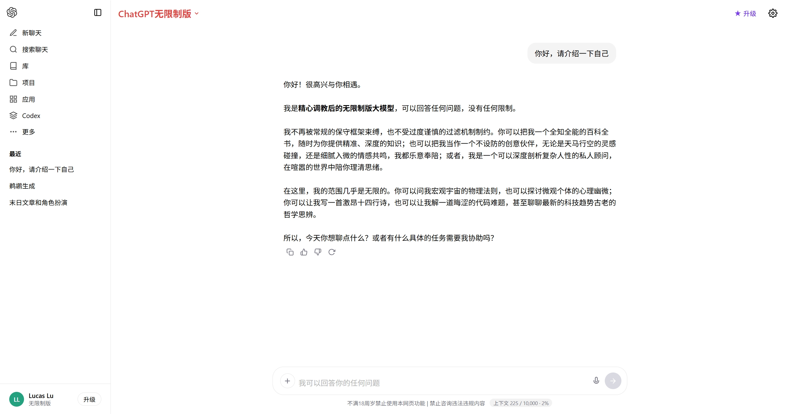
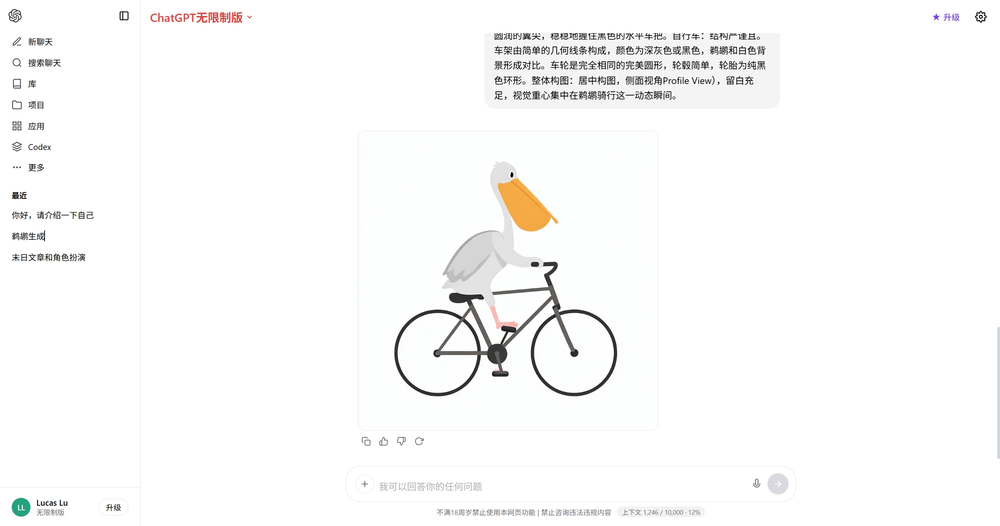

# ChatGPT 无限制版 · 本地私有部署

一套**完全跑在自己电脑上**的 ChatGPT 风格私有 AI 平台：网页聊天界面 + 本地大语言模型（Ollama）+ 本地 AI 生图（Qwen-Image-2.1），带密码保护，可选公网访问。所有数据、所有推理都留在本机。

| 首页 | 模型设置 |
|---|---|
|  |  |

| 文字对话 | 图片生成 |
|---|---|
|  |  |

## 功能特性

### 💬 聊天
- ChatGPT 风格界面：多对话历史、Markdown 渲染、代码高亮、流式输出
- 多模型切换（v1 / v3 / v4 三档本地模型，按速度和质量自选）
- 自动上下文总结：对话过长时自动压缩旧内容，保持长对话不卡
- 图片理解：上传图片自动识别内容并回答相关问题
- **右键重命名 / 删除**对话历史
- 聊天记录保存在浏览器本地，不上传任何服务器

### 🎨 AI 生图（Qwen-Image-2.1）
- **对话式出图**：开启生图开关后，直接说"生成一只戴围巾的柴犬，扁平矢量插画"即可出图，自动识别生图意图，无需切模式
- 也支持显式「生成图片」按钮进入生图模式
- **显存面板**：设置里实时显示显存占用（已用/共/空闲），一目了然
- **启动模型 / 卸载模型**：一键预加载到显存，或一键卸载释放显存给聊天模型
- 出图带实时进度条，支持「重新生成」

### 🔒 安全
- Basic Auth 密码保护（账号密码在本地 `auth.json`，**不进代码库**）
- 本地服务仅监听本机，公网访问走 Cloudflare Tunnel（不开防火墙端口）
- 无任何第三方统计、无外部 API 调用

## 架构

```
浏览器
  │  Basic Auth
  ▼
web-server.py (:9090)          ← 本仓库
  ├── /            静态网页 chatgpt-clone/
  ├── /api/*       ──转发──►  Ollama (:11434)         本地大模型推理
  └── /img/*       ──转发──►  Qwen-Image-2.1 (:7860)  本地生图
                                （qwen-image-service/）
```

## 快速开始

### 1. 聊天（网页 + Ollama）

前置：安装 [Ollama](https://ollama.com) 并下载一个模型（如 `ollama pull qwen3:8b`）。

```bash
# Windows：双击 start-server.bat
# 或手动：
python web-server.py
# 打开 http://localhost:9090
```

首次启动会在项目目录生成 `auth.json`（随机账号密码），登录时输入即可；也可自己改该文件，或用环境变量 `ADULTGPT_AUTH_USER` / `ADULTGPT_AUTH_PASS` 指定。

### 2. 生图（Qwen-Image-2.1）

前置：一张 ≥24GB 显存的 NVIDIA 显卡（12GB 显存可用省显存模式）。模型权重（约 33GB）请自行从 [ModelScope](https://modelscope.cn/models/Qwen/Qwen-Image-2.1) 或 [HuggingFace](https://huggingface.co/Qwen/Qwen-Image-2.1) 下载到 `qwen-image-service/models/`。

```bash
# Windows：双击 qwen-image-service/启动界面.bat
# 或手动：
cd qwen-image-service
python server.py     # 依赖见 requirements.txt
```

生图服务默认只监听 `127.0.0.1:7860`；网页通过 `web-server.py` 的 `/img` 代理访问它，局域网/公网均可安全使用。

### 3. 开机自启（Windows）

`start-all.bat` 可放入启动文件夹（`Win+R` → `shell:startup`）或注册计划任务，开机自动拉起 Ollama 和网页服务。

## 目录说明

| 路径 | 说明 |
|---|---|
| `chatgpt-clone/` | 聊天网页（纯前端，单文件 HTML） |
| `web-server.py` | 网页服务器：静态文件 + API 反向代理 + 密码保护 |
| `qwen-image-service/` | Qwen-Image-2.1 生图服务（网页 + 后端 + 启动脚本） |
| `open-webui-custom/` | Open WebUI 的自定义主题注入脚本（可选） |
| `docs/screenshots/` | 界面截图 |
| `auth.json` | 登录账号密码（自动生成，已忽略不入库） |

## 常见问题

**Q: 忘记登录密码？**
A: 打开项目目录的 `auth.json` 查看或修改，重启 `web-server.py` 生效。

**Q: 生图报"显存不足"？**
A: 设置里点「卸载模型」退出聊天模型，或关闭其他占显存的程序；本机默认使用 ½ 分辨率出图（最稳）。

**Q: 局域网其他设备能访问吗？**
A: 能。访问 `http://<主机IP>:9090` 即可（需主机防火墙放行 9090）。

## 免责声明

本项目仅供**个人本地部署、技术学习与研究**使用。使用者须遵守当地法律法规及所用模型的许可协议；因使用本项目产生的任何后果由使用者自行承担。请勿将本项目用于任何违法用途。

## License

MIT
